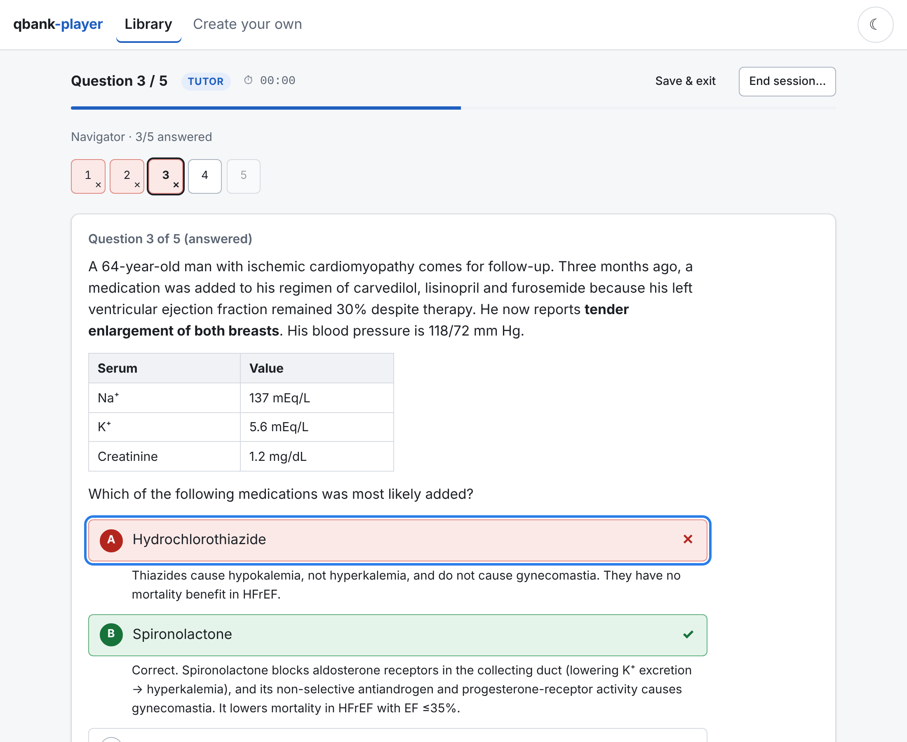
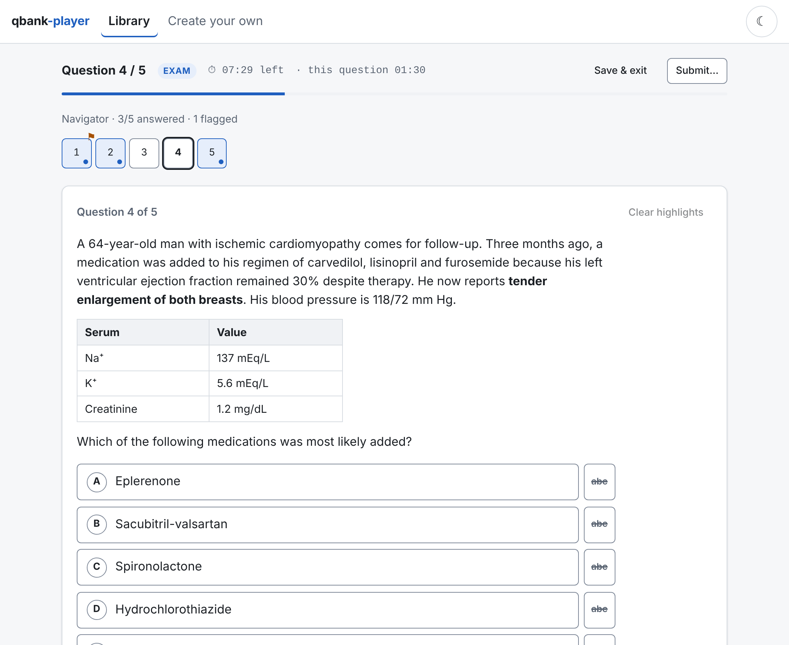
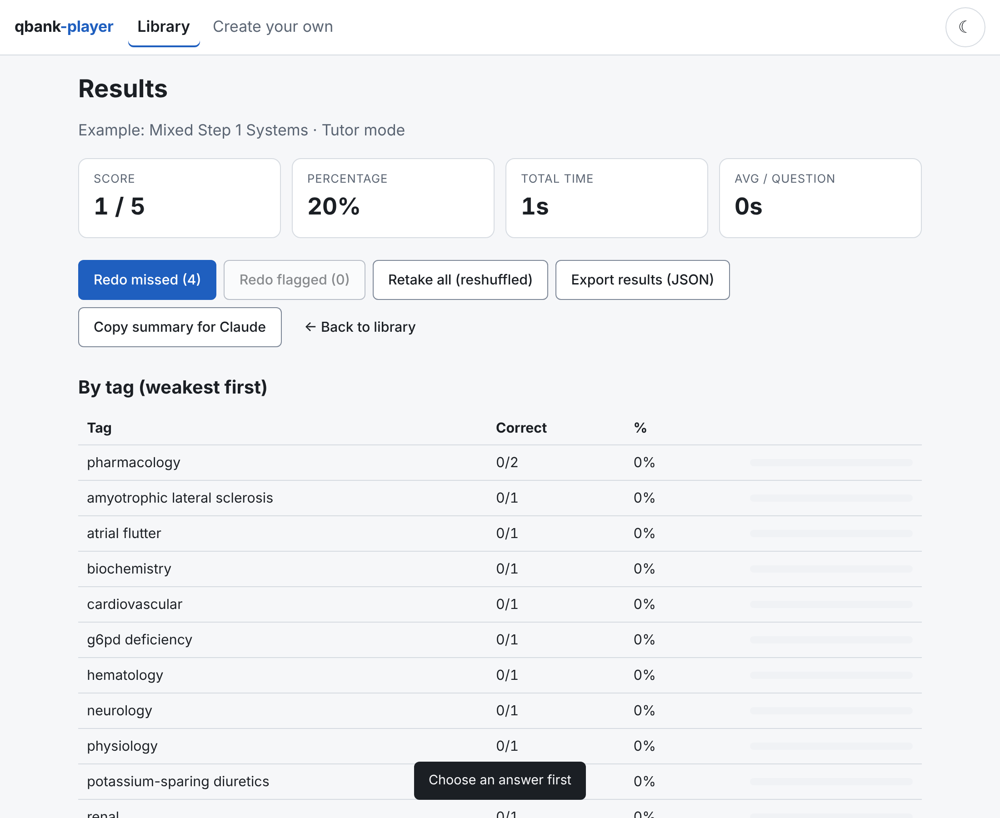
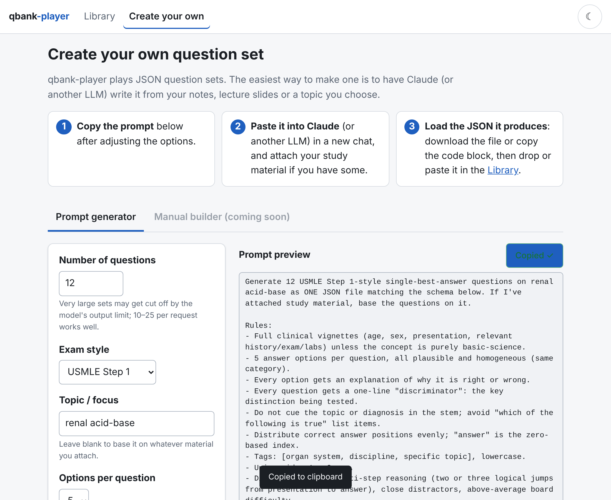

# qbank-player

A static, framework-free web app for playing board-style (USMLE Step 1 / COMLEX Level 1) single-best-answer question sets stored as JSON files. You can generate those sets with Claude (or another LLM) using a prompt the site gives you.

- **Tutor mode**: pick an option, then press **Submit answer** (or `Enter`) to lock it in; you can change your pick until you submit. Right after submitting you see whether it was correct, an explanation for every option, the key distinction being tested, the question's tags and its source.
- **Exam mode**: no feedback until the end. You can move between questions, flag them, and change answers until you submit. An optional block timer is available.
- **Strike out options** in either mode to rule them out: use the strike button at the right of each option, right-click it, long-press it on touch screens, or press `Shift` with its letter. A struck option can still be selected, which removes the strike. Strikes are saved with your progress, shown in the results review, and don't affect scoring.
- **Results**: score and timing, a per-tag breakdown (weakest first), a review list you can filter to missed or flagged questions, buttons to redo missed, redo flagged or retake all, a JSON export, and a "Copy summary for Claude" button for requesting a targeted follow-up set.
- Plain HTML, CSS and ES modules. No build step, no dependencies, no CDNs, no trackers. Works offline once loaded.

| Tutor feedback | Exam mode |
|---|---|
|  |  |
| **Results** | **Create your own** |
|  |  |

## Using it

Open the hosted site (GitHub Pages), or run it locally:

```bash
python3 -m http.server 8000
```

Then visit <http://localhost:8000/>.

> **Serve it over HTTP. Opening `index.html` directly from disk (`file://`) won't work**, because browsers refuse to load ES modules from `file://`. Any static server works, for example `npx serve` or `php -S localhost:8000`.

On the **Library** page you can load a set in four ways:

- drag and drop a `.json` file anywhere on the page;
- **Choose file…**;
- paste the JSON into the text box. Markdown code fences and chatty text around the JSON are ignored;
- open a link like `?set=sets/example.json` or `?set=https://example.org/my-set.json`. For another site, that server has to allow cross-origin requests (CORS).

After a set loads you pick the mode, timer, shuffling, a tag filter (or **Missed last session**) and how many questions to use, then start.

### Keyboard shortcuts

| Key | Action |
|---|---|
| `A`–`H` or `1`–`8` | Select an option. `F` is the flag key, so use `6` for option F. In tutor mode this only marks your pick; it isn't graded until you submit |
| `Enter` | Tutor mode: submit the selected answer, then go to the next question. Exam mode: next question. Finish / Submit on the last one |
| `Shift` + `A`–`H` or `1`–`8` | Strike out an option, or restore it |
| `F` | Flag or unflag the question |
| `←` / `→` | Previous / next. In tutor mode you can only go back to answered questions |
| `Esc` | Close a dialog or the image viewer |

### Highlighting

In either mode, select text in the question stem with the mouse or by touch, then tap the **Highlight** button that appears below the selection. Click a highlight to remove it, or use **Clear highlights** above the question. Highlights are saved with your progress and also show in the results review. Selecting text inside an answer option doesn't choose that option.

Progress is saved in your browser after every answer, so a refresh resumes where you left off. Recently opened sets appear in the Library with a **Resume** button.

## Generating sets with Claude

1. Go to **Create your own** (`create.html`). Choose the number of questions, exam style, topic, options per question and difficulty.
2. Click **Copy prompt**. Paste it into a new chat with Claude (or another LLM), and attach your notes, slides or PDFs if you want the questions based on them. The prompt includes the full schema, so nothing else is needed.
3. Save the `.json` file Claude creates, or copy its code block, and drop or paste it into the Library. If something is off, the Library tells you exactly what, for example `q7: answer index 5 out of range (4 options).`

Tips:

- 10–25 questions per request works well. Very large sets can be cut off by the model's output limit, and the loader will say the JSON looks truncated.
- After a session, click **Copy summary for Claude** and paste it into the same chat to get a follow-up set aimed at your weak tags and the questions you missed.
- Common LLM quirks are handled automatically: code fences, prose around the JSON, a byte-order mark, and trailing commas or "smart quotes". Repairs are reported as warnings.

## Schema reference (v1)

The formal definition is in [`schema.json`](schema.json) (JSON Schema draft 2020-12).

```json
{
  "title": "Renal pharm",
  "version": 1,
  "description": "Optional short description.",
  "questions": [
    {
      "id": "q1",
      "stem": "A 64-year-old man … **bold**, *italic*, line breaks and simple | pipe | tables |",
      "image": "https://… | relative/path.png | data:image/…",
      "options": [
        { "text": "Spironolactone", "explanation": "Why it's right." },
        { "text": "Eplerenone", "explanation": "Why it's wrong." }
      ],
      "answer": 0,
      "discriminator": "One line: the key distinction tested.",
      "explanation": "Optional overall teaching point, same formatting as the stem.",
      "explanationImages": ["https://… | relative/path.png | data:image/…"],
      "tags": ["renal", "pharmacology", "potassium-sparing diuretics"],
      "source": "Sketchy Pharm p.12"
    }
  ]
}
```

| Field | Required | Notes |
|---|---|---|
| `title` | ✓ | Non-empty string. |
| `version` | ✓ | Must be `1`. |
| `description` | | String shown on the start screen. |
| `questions` | ✓ | At least 1 question. |
| `questions[].id` | ✓ | Unique within the set (`q1`, `q2`, …). |
| `questions[].stem` | ✓ | Supports `**bold**`, `*italic*`, `` `code` ``, line breaks (`\n`) and simple Markdown pipe tables. |
| `questions[].image` | | `http(s)://` URL, a relative path (relative to `index.html`), or a `data:image/…` URI. Other schemes are rejected. |
| `questions[].options` | ✓ | 2–8 items, each `{ "text", "explanation" }` (both required, non-empty). Shown labeled A–H. |
| `questions[].answer` | ✓ | Zero-based index into `options`. |
| `questions[].discriminator` | | Shown in a highlighted "Key distinction" box after answering. |
| `questions[].explanation` | | Overall explanation of the question. Same formatting as the stem. An empty string is treated as absent. |
| `questions[].explanationImages` | | Array of images for the explanation. Each follows the same rules as `image`. |
| `questions[].tags` | | Array of strings, used for filtering and the per-tag breakdown. Hidden until a question is answered. |
| `questions[].source` | | Free-text reference. |

Unknown fields produce warnings rather than errors, so slightly over-eager LLM output still loads.

### Results export format

**Export results** downloads `<title-slug>-results-YYYY-MM-DD-HHmm.json`:

```json
{
  "setTitle": "…", "setVersion": 1, "mode": "tutor", "timestamp": "2026-11-20T14:03:00.000Z",
  "score": 7, "total": 10,
  "responses": [{ "id": "q1", "chosen": 2, "correct": true, "timeMs": 48211, "flagged": false, "tags": ["…"] }]
}
```

`chosen` is the **original** option index from the set file (or `null` if unanswered), whatever order the options were shown in.

## Adding sets to `/sets`

1. Put the file in `sets/`, for example `sets/renal-pharm.json`.
2. Add an entry to `sets/index.json`:
   ```json
   [
     { "file": "example.json", "title": "Example: Mixed Step 1 Systems", "count": 5 },
     { "file": "renal-pharm.json", "title": "Renal pharm", "count": 20 }
   ]
   ```
3. Run `node tests/validate.test.mjs`. It validates every set and checks that `title` and `count` in the manifest match the file. CI runs the same check on every push and pull request.

Each bundled set gets a shareable link: `https://<user>.github.io/qbank-player/?set=sets/renal-pharm.json`.

## Privacy

- **Files you load from your computer or paste never leave your browser.** They are parsed locally. Progress, recent sets and preferences are stored in your browser only (localStorage and IndexedDB). There is no server, analytics or tracking.
- **Anything committed to `/sets` is public** once the site is deployed. Don't commit copyrighted question banks, or material you aren't allowed to share.
- Anything you paste into Claude or another LLM is sent to that provider under its terms.
- Set content is treated as untrusted. HTML in sets is escaped and never rendered, and images are only loaded from allowed URL schemes.

## Development

```text
index.html, create.html   pages
css/styles.css            all styles (light/dark tokens)
js/app.js                 index.html entry: routing, state, library view
js/start.js, quiz.js, results.js   views
js/render.js, dom.js      shared rendering and DOM helpers (modal, lightbox, clipboard)
js/loader.js              file/URL/paste parsing, fence stripping, repairs, parse errors
js/validate.js            hand-rolled schema validator (no DOM; runs in Node)
js/session.js             session building, shuffling with answer remap, scoring, export (no DOM)
js/storage.js             localStorage + IndexedDB, all failures handled
js/prompt.js              the ONE prompt template + inline schema copy
js/create.js              create page (tab registry; manual builder slot)
js/util.js                seeded shuffle, slug, hash, markdown-lite renderer, URL allowlist
schema.json               JSON Schema (must equal the copy in js/prompt.js; a test enforces it)
tests/validate.test.mjs   unit tests + validation of every bundled set (no deps)
tests/smoke.mjs           Playwright end-to-end smoke test + axe-core accessibility scans (local only)
```

```bash
node tests/validate.test.mjs
```

```bash
npm install   # once: dev-only axe-core for the accessibility scans
node tests/smoke.mjs --screenshots
```

The second command needs Playwright and Chromium available. It also scans each view in light and dark themes with axe-core and fails on serious or critical accessibility violations. axe-core is a devDependency injected by the test; the site never loads it. It serves the site under `/qbank-player/` to mimic GitHub Pages; with `--screenshots` it also refreshes the images in `docs/screenshots/`.

### Deployment

`.github/workflows/pages.yml` runs the tests and deploys the repository root to GitHub Pages on every push to `main`. One-time setup: **Settings → Pages → Build and deployment → Source: GitHub Actions**.

All paths are relative, so the site works from a subpath (`/qbank-player/`) or from any static host.

## License

[MIT](LICENSE)
